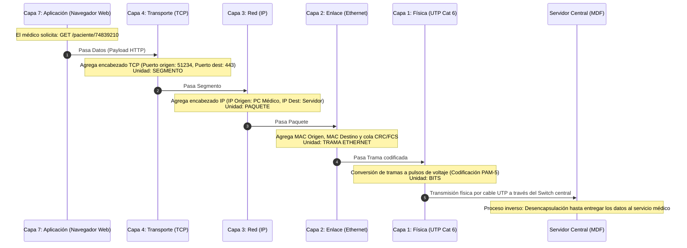

# 7. Tipo y Topología de Red

### 7.1. Clasificación por Alcance Geográfico
La red diseñada se clasifica como una **Red de Área Local (LAN - Local Area Network)** debido a que interconecta dispositivos informáticos concentrados dentro de un único edificio con un radio de cobertura no superior a los 100 metros.
- **Ámbito:** Red privada interna del Policlínico San Gabriel.
- **Medio de transporte:** Medios guiados de cobre (Cable UTP Cat 6) para estaciones fijas y medios no guiados (Ondas electromagnéticas Wi-Fi 802.11ax) para movilidad de médicos y pacientes.

### 7.2. Topología Física: Estrella Centralizada
Para el Policlínico San Gabriel se ha seleccionado e implementado una **Topología Física en Estrella**:
- **Punto central:** Todos los enlaces de cableado horizontal convergen de manera radial en un único **Gabinete de Telecomunicaciones (Rack de 19 pulgadas)** ubicado en el cuarto de servidores (MDF).
- **Conectividad:** Cada punto terminal (PC, cámara IP, AP, impresora) dispone de un tramo de cable UTP exclusivo e independiente que llega directamente hasta un puerto del Patch Panel en el rack.

**Justificación técnica de la elección:**
1. **Aislamiento de fallas:** Si un cable UTP sufre un corte accidental o un conector se deteriora, únicamente queda fuera de servicio ese puesto específico sin afectar el funcionamiento del resto de consultorios.
2. **Facilidad de administración:** Toda la concentración de líneas, etiquetado y conmutación se realiza en un único punto físico centralizado.
3. **Escalabilidad modular:** Agregar un nuevo consultorio o cámara IP simplemente requiere tender un cable hasta el rack y poncharlo en un puerto disponible del switch sin suspender el servicio.

### 7.3. Topología Lógica: Estrella / Bus Broadcast Ethernet
Aunque físicamente el cableado tiene forma de estrella hacia el switch, en el nivel de enlace de datos (Capa 2) la red opera bajo el estándar **IEEE 802.3 Ethernet**. El switch conmuta las tramas mediante tablas de direcciones MAC de forma dedicada por puerto (microsegmentación sin colisiones).

---

# 8. Modelos de Referencia: OSI y TCP/IP

### 8.1. Comparativa y Mapeo de Capas en el Escenario del Policlínico

| Capa Modelo OSI | Capa Modelo TCP/IP | Protocolo / Tecnología en el Policlínico | Rol en la Red del Policlínico |
| :--- | :--- | :--- | :--- |
| **7. Aplicación** | **Aplicación** | HTTP/HTTPS, DNS, DHCP, DICOM (Rayos X) | Software de historias clínicas electrónicas web y visualizador de imágenes médicas. |
| **6. Presentación** | (Integrada en Aplicación) | SSL/TLS, JPEG/DICOM, ASCII | Cifrado de datos médicos sensibles del paciente y compresión de radiografías. |
| **5. Sesión** | (Integrada en Aplicación) | RPC, NetBIOS, sockets TCP | Mantenimiento de la sesión activa del médico durante la consulta. |
| **4. Transporte** | **Transporte** | TCP (para EHR, base de datos) / UDP (para streaming de cámaras y DNS) | Control de flujo y retransmisión de datos médicos garantizando entrega ordenada. |
| **3. Red** | **Internet** | Protocolo IP (IPv4) *(diseño lógico proyectado a U-II)* | Identificación lógica de origen y destino de cada equipo del centro médico. |
| **2. Enlace de Datos** | **Acceso a la Red** | IEEE 802.3 Ethernet (Cables) / IEEE 802.11ax (Wi-Fi) | Encabezado con direcciones MAC origen y destino; detección de errores mediante FCS/CRC. |
| **1. Física** | (Integrada en Acceso a la Red) | UTP Cat 6, conectores RJ-45, codificación 1000BASE-T (PAM-5) | Transmisión de señales eléctricas mediante pulsos de voltaje a través de pares de cobre. |

---

### 8.2. Proceso Detallado de Encapsulación y Desencapsulación

A continuación se detalla el ciclo completo de vida de los datos cuando el **Médico del Consultorio 1** abre la historia clínica de un paciente almacenada en el **Servidor Central del Policlínico**:

#### Fases de la Encapsulación:
1. **Generación de Datos (Capa de Aplicación):** El médico ingresa el DNI del paciente en el sistema web. Se genera una solicitud HTTP/HTTPS formateada en texto y cifrada mediante TLS.
2. **Segmentación (Capa de Transporte):** Los datos se dividen si superan el tamaño máximo de segmento (MSS). Se añade la cabecera **TCP** indicando número de secuencia, reconocimiento y los puertos (Puerto destino 443 HTTPS). El PDU resultante es un **Segmento**.
3. **Empaquetado (Capa de Red):** Se incorpora la cabecera **IP** con la dirección lógica del equipo del médico y la dirección del servidor central. El PDU resultante es un **Paquete**.
4. **Entramado (Capa de Enlace de Datos):** El paquete IP se coloca dentro de una **Trama Ethernet 802.3**. Se añade la dirección física **MAC** de la tarjeta de red del PC médico (origen) y la dirección MAC de la interfaz del switch/servidor (destino), junto con un campo FCS (Frame Check Sequence) al final para verificar que no haya corrupción en la llegada.
5. **Codificación de Bits a Señal (Capa Física):** La tarjeta de red (NIC) convierte la secuencia de ceros y unos de la trama en **señales eléctricas moduladas en 5 niveles de tensión (PAM-5)** transmitidas en paralelo a través de los 4 pares de hilos de cobre del cable UTP Categoría 6 hasta el switch central.
